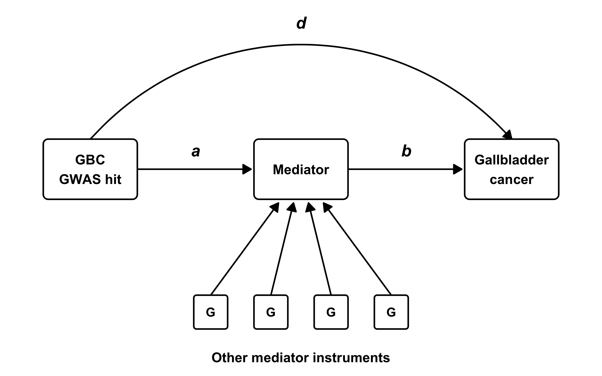

# Methods

## Gallbladder cancer GWAS

Summary statistics for gallbladder cancer (GBC) were taken from the [G1 + G2 meta-analysis; sample size and ancestry to be added], with effects on the log-odds scale. Eight lead variants were carried forward: rs67274221, rs35604230, rs60541816, rs6733452, rs2312959, rs15734, rs2131242 and rs77155094. Seven of these reached P < 5 × 10⁻⁸; rs2131242 had P = 9.9 × 10⁻⁷.

## PheWAS

We looked up each lead variant in the IEU OpenGWAS database (Elsworth et al., 2020) for associations with other traits at P < 1 × 10⁻⁵. This returned 423 associations across 370 GWAS datasets. From these we chose 26 traits as candidate mediators of the GBC association, covering haematological, lipid, liver-function, anthropometric, blood-pressure, endocrine and gallbladder/biliary traits. Each trait was represented by one OpenGWAS dataset.

## Follow-up Mendelian randomization

For each candidate mediator we used OpenGWAS to extract genome-wide significant instruments (P < 5 × 10⁻⁸). These were LD-clumped at r² < 0.001 within a 10 Mb window, using the 1000 Genomes European reference panel. We also extracted the association of each GBC lead variant with each mediator. A lead-variant–mediator pair was kept if that exact variant reached P < 5 × 10⁻⁸ for the mediator; proxies were not used. This gave 33 unique pairs, covering 26 mediators and six lead variants. Neither rs2312959 nor rs77155094 reached P < 5 × 10⁻⁸ for any selected mediator.

We harmonised mediator and GBC associations to the same effect allele. All palindromic (A/T, C/G) variants were removed, whatever their allele frequency. For each pair we estimated two things:

- **Exact-hit estimate.** The Wald ratio of the lead variant's GBC association to its mediator association.
- **Other-instrument estimate.** An MR estimate of the mediator's effect on GBC, using all other instruments for that mediator. We removed every instrument within ±1 Mb of any of the eight GBC lead variants. This estimate was shared by all pairs for that mediator. We used inverse-variance weighted (IVW) MR with multiplicative random effects, or a Wald ratio when only one instrument remained.

If the lead variant affects GBC only through the mediator, the two estimates should agree. We tested this with a one-degree-of-freedom Cochran's Q statistic, Q = (β_exact − β_other)² / (SE²_exact + SE²_other). We recorded instrument strength (F = β²/SE²) for every instrument. As a sensitivity analysis, we widened the exclusion to ±2 Mb, with and without also excluding the extended MHC (chr6:25–34 Mb). The pooled mediator→GBC IVW estimates are reported for each mediator.

## Direct and indirect effect estimation

For each lead variant G, mediator M and GBC outcome Y (Figure 1), let:

- *a* = the G→M association;
- *b* = the M→Y other-instrument MR estimate above;
- *t* = the G→Y association.

All three use the same effect allele. We estimated:

- the total effect, *t*;
- the indirect effect through M, *i* = *a* × *b*;
- the residual direct effect, *d* = *t* − *i*.

All three are expressed in GBC log odds per effect allele. Standard errors came from the first-order delta method: Var(*i*) = *b*²Var(*a*) + *a*²Var(*b*) and Var(*d*) = Var(*t*) + Var(*i*). The covariances between *a*, *b* and *t* can't be identified from summary data, so the primary analysis set them to zero. As a sensitivity analysis, we recomputed intervals assuming equal correlations of −0.3, 0 and 0.3. Each mediator was analysed on its own, and indirect effects were not summed across mediators. Because GBC is binary and odds ratios are non-collapsible, we treat *d* as a model-based residual. It should not be read as an identified natural direct effect.

## Effect captured through mediators

To summarise how much of each lead variant's effect runs through its mediators, we took as candidates the mediators whose pooled MR estimate had P < 0.05. We treated cholelithiasis and FinnGen disorders of gallbladder, biliary tract and pancreas as one liability, represented by cholelithiasis. A lead variant with one candidate mediator kept its decomposition from above. For a lead variant with several candidate mediators (rs35604230: platelet count, rheumatoid arthritis and diastolic blood pressure), we estimated the mediators' effects on GBC jointly by multivariable MR (MVMR). The partitioning is described below.

## Partitioning direct and indirect effects with multivariable MR

**Model.** Take a lead variant G with *K* selected mediators M₁, …, M_K. We modelled its total association with GBC as

*t* = *d* + Σⱼ *a*ⱼ*b*ⱼ,

where:

- *a*ⱼ is G's association with Mⱼ, taken from the Mⱼ GWAS;
- *b*ⱼ is the direct effect of Mⱼ on GBC, holding the other K − 1 mediators fixed;
- *d* is the residual direct effect of G, which acts through none of the *K* mediators.

With one mediator (*K* = 1) this is the decomposition in Figure 1, with *b* from univariable MR. With several mediators, univariable estimates cannot simply be summed. If the mediators are causally related, or share genetic determinants, each univariable *b*ⱼ partly carries the effects of the others, and the summed indirect effects would double-count the shared pathways. Conditional estimates from MVMR avoid this.

**Instruments.** MVMR instruments were extracted from OpenGWAS with TwoSampleMR's `mv_extract_exposures()`. This took the union of each mediator's instruments (P < 5 × 10⁻⁸), clumped them jointly (r² < 0.001, 10 Mb, 1000 Genomes European reference) and looked up every instrument in every mediator GWAS, without proxies. We removed palindromic variants and all variants within ±1 Mb of any GBC lead variant. The remaining variants were harmonised to the GBC GWAS.

**Estimation.** Let β̂_Y be the vector of instrument–GBC associations, with standard errors σ_Y, and let B̂ be the *n* × *K* matrix of instrument–mediator associations. We estimated *b* = (*b*₁, …, *b*_K) by inverse-variance weighted (IVW) MVMR. This is a weighted least-squares regression of β̂_Y on B̂ with no intercept and weights W = diag(σ_Y⁻²). Its covariance matrix used multiplicative random effects:

V = (B̂ᵀWB̂)⁻¹ × max(1, φ), with φ = Q / (*n* − *K*),

where Q is Cochran's heterogeneity statistic.

**Diagnostics.**
- *Instrument strength.* We assessed each mediator's conditional instrument strength with the Sanderson–Windmeijer conditional F statistic (Sanderson et al., 2021), treating F < 10 as weak. Overlap between the mediator GWAS samples is unknown, so the covariance between their instrument associations was set to zero.
- *Conditioning versus instrument loss.* We also ran a univariable IVW for each mediator, restricted to its own genome-wide significant instruments within the MVMR instrument set. Comparing this with the MVMR estimate shows how much attenuation comes from conditioning and how much from the change in instruments.

**Partitioning.** The indirect effect through Mⱼ was *i*ⱼ = *a*ⱼ*b*ⱼ, and the total indirect effect was *i* = Σⱼ *i*ⱼ. The residual direct effect was *d* = *t* − *i*, and the mediated share was *i* / *t*. Components can have opposite signs, so the share is not bounded by 0 and 1. A negative share means the indirect effect opposes the total, which we report as negative mediation.

**Uncertainty.** Standard errors came from the first-order delta method. We assumed that the *a*ⱼ are independent of each other and of *b*, and that *t* is independent of both. We used the full MVMR covariance matrix V, so correlations between the conditional estimates carry through to the indirect effect:

- Var(*i*ⱼ) = *b*ⱼ²Var(*a*ⱼ) + *a*ⱼ²V_jj
- Var(*i*) = Σⱼ *b*ⱼ²Var(*a*ⱼ) + **a**ᵀV**a**
- Var(*d*) = Var(*t*) + Var(*i*)

95% confidence intervals were estimate ± 1.96 × SE.

**Sensitivity analysis.** We repeated the MVMR, excluding variants within ±2 Mb of any lead variant and also the extended MHC (chr6:25–34 Mb).

**Interpretation.**
- The partition is linear on the log-odds scale. Odds ratios are non-collapsible, so *d* is a model-based residual rather than an identified natural direct effect. *d* also absorbs any effect through mediators outside the selected set.
- MVMR assumes the instruments affect GBC only through the included mediators.
- Mediators were selected on their association with GBC in the same GBC data, so the *b*ⱼ, and hence the shares, may be inflated by winner's curse and are exploratory.

**Display.** For display, each lead variant was oriented to its GBC risk-increasing allele, as in the PheWAS. Flipping the allele changes the sign of *t* and of every component, but not the mediated share.

## Multiple testing

P-values were adjusted with the Benjamini–Hochberg method, separately within each family of tests: the 33 pairwise heterogeneity tests, the 26 pooled mediator MR estimates, the 33 indirect effects and the 33 residual direct effects.

## Software

Data were extracted from OpenGWAS with ieugwasr and TwoSampleMR in August–September 2026, and MVMR instruments in October 2026. All analyses were rerun offline from these saved extracts, using R 4.6.1, TwoSampleMR 0.7.12 (Hemani et al., 2018), ieugwasr 1.2.0, data.table 1.18.4, knitr 1.51, rmarkdown 2.31 and Quarto 1.9.37. Code and results are available at [repository URL].

## Figure 1

**Figure 1. Analysis design.** Each GBC GWAS hit is paired with a mediator identified in the PheWAS. *a* is the hit's association with the mediator. *b* is the mediator's effect on gallbladder cancer, estimated by MR using other instruments for the mediator, with all regions within ±1 Mb of a GBC lead variant excluded. *d* is the residual direct effect of the hit that does not act through the mediator. The total association of the hit with gallbladder cancer, *t*, decomposes as *t* = *d* + *a* × *b*.

## References

- Elsworth B, Lyon M, Alexander T, et al. The MRC IEU OpenGWAS data infrastructure. *bioRxiv* 2020. doi:10.1101/2020.08.10.244293
- Hemani G, Zheng J, Elsworth B, et al. The MR-Base platform supports systematic causal inference across the human phenome. *eLife* 2018;7:e34408. doi:10.7554/eLife.34408
- Sanderson E, Spiller W, Bowden J. Testing and correcting for weak and pleiotropic instruments in two-sample multivariable Mendelian randomization. *Stat Med* 2021;40:5434–5452. doi:10.1002/sim.9133
- Carter AR, Sanderson E, Hammerton G, et al. Mendelian randomisation for mediation analysis: current methods and challenges for implementation. *Eur J Epidemiol* 2021;36:465–478. doi:10.1007/s10654-021-00757-1
